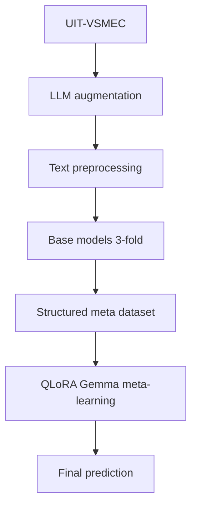

# An LLM-Augmented Stacked Ensemble for Vietnamese Emotion Recognition on Social Media

This repository is the code for the conference paper [Docs/conference_paper.tex](Docs/conference_paper.tex) ([PDF](Docs/conference_paper.pdf)). The paper studies fine-grained emotion recognition on [UIT-VSMEC](https://nlp.uit.edu.vn/datasets), a seven-class Vietnamese social-media corpus.

The reported method has two stages. In Stage 1, Gemini-2.5-Flash generates and paraphrases minority-class sentences with 10-shot prompting. In Stage 2, five base classifiers—PhoBERT, CafeBERT, ViBERT, Logistic Regression, and LinearSVC—produce class probabilities, and a QLoRA-fine-tuned Gemma-2-9B-it meta-model reads the raw sentence together with those five distributions.

On the same split, preprocessing, and 692-sentence test set, averaged over seeds 42, 131, and 9998, the full framework reaches **0.7033 ± 0.0133** accuracy, **0.7039 ± 0.0126** weighted F1, and **0.6727 ± 0.0125** macro F1.

Nguyễn Gia Huy and Nguyễn Thị Thanh Sang. Author details are in the paper.

## Contributions

- An LLM augmentation protocol that generates and paraphrases Vietnamese social-media sentences for minority emotion classes with controlled 10-shot prompting.
- A stacked ensemble in which QLoRA-fine-tuned Gemma-2-9B-it consumes the raw sentence and the five base-model probability distributions.

## Project Focus

- **Evaluation corpus**: UIT-VSMEC (`Enjoyment`, `Sadness`, `Fear`, `Anger`, `Disgust`, `Surprise`, `Other`).
- **Stage 1**: Gemini-2.5-Flash minority-class generation and paraphrasing, then shared Vietnamese social-media preprocessing.
- **Stage 2**: Heterogeneous base models, a structured meta dataset, and QLoRA Gemma-2-9B-it as the meta-model.
- **Canonical write-up**: [Docs/conference_paper.tex](Docs/conference_paper.tex).

## Dataset

### UIT-VSMEC (emotion)

- **Corpus**: [UIT-VSMEC](https://nlp.uit.edu.vn/datasets) (Vietnamese Social Media Emotion Corpus), 6,927 annotated sentences.
- **Labels**: `Enjoyment`, `Sadness`, `Fear`, `Anger`, `Disgust`, `Surprise`, `Other`.
- **Working format**: `text` (Vietnamese sentence) and `label` (emotion category).
- **Test set used in the paper**: 692 sentences, shared across the same-protocol comparison.

---

## Environment Setup

The pipeline was developed and executed primarily on **Google Colab** with GPU acceleration and high-RAM runtimes. Local execution is possible with equivalent CUDA hardware, but Colab is the documented path. The paper’s experiments used an NVIDIA A100 80GB GPU.

### Software dependencies

From the repository root:

```bash
python -m venv .venv
source .venv/bin/activate   # Windows: .venv\Scripts\activate
pip install -r requirements.txt
```

Ensemble notebooks additionally install, via `%pip install` in their first cells:

`torchao`, `peft`, `trl`, `bitsandbytes`, `accelerate`, `transformers`, `datasets`

*(These packages are also listed in [`requirements.txt`](requirements.txt) for local installs.)*

### API keys and secrets

| Variable | Used by | Configuration |
| --- | --- | --- |
| `GOOGLE_API_KEY` | [`augmentation/Data_Augmentation_LLM.ipynb`](tm_research/augmentation/Data_Augmentation_LLM.ipynb) | Colab Secret or [`tm_research/.env`](tm_research/.env) |
| `HF_TOKEN` | [`ensemble/06_train_meta_lora_gemma.ipynb`](tm_research/ensemble/06_train_meta_lora_gemma.ipynb) | Colab Secret; accept [Gemma-2 license](https://huggingface.co/google/gemma-2-9b-it) on HuggingFace |

For `HF_TOKEN`, create a token at [huggingface.co/settings/tokens](https://huggingface.co/settings/tokens) and accept the license at [google/gemma-2-9b-it](https://huggingface.co/google/gemma-2-9b-it). In Colab, add the token via the key icon in the sidebar (**Secrets**) and grant notebook access.

### Hardware requirements (Google Colab)

| Resource | Requirement |
| --- | --- |
| GPU | CUDA-enabled: **A100** (preferred), **T4**, or **G4** |
| System RAM | **High-RAM** mode; 22–80 GB depending on runtime |
| Notebook 06 peak RAM | ~**80 GB** |
| VRAM (notebooks 06–07) | ~**24 GB** (4-bit QLoRA on `google/gemma-2-9b-it`) |
| Storage | Google Drive mount recommended for artifact persistence |

| Notebook | GPU | RAM (approx.) | Notes |
| --- | --- | --- | --- |
| [`augmentation/Data_Augmentation_LLM.ipynb`](tm_research/augmentation/Data_Augmentation_LLM.ipynb) | Optional | Low | API-bound |
| [`preprocessing/DataPreprocessing.ipynb`](tm_research/preprocessing/DataPreprocessing.ipynb) | Optional | Low | CPU sufficient |
| [`ensemble/01`](tm_research/ensemble/01_base_phobert_oof.ipynb)–[`04`](tm_research/ensemble/04_base_sklearn_oof.ipynb) | **Required** | 22–40 GB | 3-fold OOF, 20 epochs each |
| [`ensemble/05`](tm_research/ensemble/05_weights_and_meta_dataset.ipynb) | Optional | Low | Builds JSONL meta-dataset |
| [`ensemble/06`](tm_research/ensemble/06_train_meta_lora_gemma.ipynb) | **Required** | ~80 GB | QLoRA meta-model training |
| [`ensemble/07`](tm_research/ensemble/07_evaluate_ensemble.ipynb) | **Required** | 40–80 GB | Inference and baseline comparison |

### Repository setup on Colab

1. Clone or upload the repository to Google Drive. The default path used in ensemble notebooks is:

   ```
   /content/drive/MyDrive/thesis/topicmodeling
   ```

2. In Colab, select **Runtime → Change runtime type**, enable a GPU (**A100** when available), and turn on **High-RAM**.

3. Mount Google Drive and configure ephemeral scratch space. Each ensemble notebook begins with a setup cell that calls `setup_colab()` from [`tm_research/ensemble/colab_setup.py`](tm_research/ensemble/colab_setup.py):

   ```python
   import os, sys
   REPO_ROOT = '/content/drive/MyDrive/thesis/topicmodeling'
   TMP_ROOT = '/content/ensemble_tmp'

   if 'google.colab' in sys.modules:
       from google.colab import drive
       if not os.path.ismount('/content/drive'):
           drive.mount('/content/drive')
       if REPO_ROOT not in sys.path:
           sys.path.insert(0, REPO_ROOT)

   from tm_research.ensemble.colab_setup import setup_colab
   paths = setup_colab(repo_root=REPO_ROOT, tmp_root=TMP_ROOT)
   ```

   This mounts Drive, routes HuggingFace cache and trainer checkpoints to `/content/ensemble_tmp`, and copies prior artifacts from Drive when resuming a session.

4. After each ensemble notebook completes, persist artifacts to Drive:

   ```python
   from tm_research.ensemble.utils_io import push_artifacts_to_persistent
   push_artifacts_to_persistent()
   ```

**How to run notebooks:** open in Jupyter, VS Code, or Colab; select the appropriate kernel; enable a GPU runtime where required; run cells top-to-bottom. Processed CSVs live under `tm_research/data/processed/` and are **not committed** to git.

Full reproduction details: [`Installation Instruction.tex`](Installation%20Instruction.tex). Reported scores are the mean ± sample standard deviation over seeds **42**, **131**, and **9998**. Each seed is one full pipeline. Hyperparameters are listed in the paper.

---

## Reproduce the Paper Result

1. Obtain UIT-VSMEC and place the raw Excel splits under `data/` (see Data retrieval below).
2. Run LLM augmentation ([`augmentation/Data_Augmentation_LLM.ipynb`](tm_research/augmentation/Data_Augmentation_LLM.ipynb)) so minority classes are filled toward 1,500 examples, then preprocess and export `train_1500_final.csv`, `val_final.csv`, and `test_final.csv` under `tm_research/data/processed/`.
3. Run ensemble notebooks [`01`](tm_research/ensemble/01_base_phobert_oof.ipynb) → [`07`](tm_research/ensemble/07_evaluate_ensemble.ipynb) sequentially on a GPU machine.
4. Inspect [`tm_research/ensemble/artifacts/metrics/ensemble_summary.json`](tm_research/ensemble/artifacts/metrics/ensemble_summary.json).

The CafeBERT runs on the original, paraphrased, and generated training sets are the augmentation ablation in the paper. They are separate from the full stacked-ensemble result.

Hyperparameters and artifact layout: [`tm_research/ensemble/WORKFLOW.md`](tm_research/ensemble/WORKFLOW.md).

---

## Additional code (outside the paper)

UIT-VSFC sentiment code is extra and is outside the paper’s evaluation. To run it: [`preprocessing/VSFC_DataPreprocessing.ipynb`](tm_research/preprocessing/VSFC_DataPreprocessing.ipynb), then [`VSFC_ensemble/01`](tm_research/VSFC_ensemble/01_base_phobert_oof.ipynb) → [`07`](tm_research/VSFC_ensemble/07_evaluate_ensemble.ipynb), with an optional demo in [`08_demo_ensemble_predict.ipynb`](tm_research/VSFC_ensemble/08_demo_ensemble_predict.ipynb). Details: [`tm_research/VSFC_ensemble/WORKFLOW.md`](tm_research/VSFC_ensemble/WORKFLOW.md). Labels are `negative`, `neutral`, and `positive` ([UIT-VSFC](https://huggingface.co/datasets/uitnlp/vietnamese_students_feedback)).

---

## End-to-End Pipeline

The paper’s pipeline has four stages after the raw corpus is in place: LLM augmentation, text preprocessing, 3-fold base classifiers, and QLoRA Gemma meta-learning.



**Canonical ensemble inputs** ([`utils_io.py`](tm_research/ensemble/utils_io.py)):

- `tm_research/data/processed/train_1500_final.csv`
- `tm_research/data/processed/val_final.csv`
- `tm_research/data/processed/test_final.csv`

Column names are normalized automatically: text from `Sentence_clean` / `Sentence` / `text`; label from `Emotion` / `label`.

---

### Data retrieval

**Sources**

- Official: [UIT NLP datasets](https://nlp.uit.edu.vn/datasets)
- Mirror: [HuggingFace `tridm/UIT-VSMEC`](https://huggingface.co/datasets/tridm/UIT-VSMEC)

**Expected local files** (8:1:1 split used across notebooks). Place under repo `data/`:

- `train_nor_811.xlsx`
- `valid_nor_811.xlsx`
- `test_nor_811.xlsx`

From the raw splits, preprocessing notebooks produce CSVs under `tm_research/data/processed/` (created at runtime, not in git).

---

### Stage 1 — LLM data augmentation

**Notebook:** [`augmentation/Data_Augmentation_LLM.ipynb`](tm_research/augmentation/Data_Augmentation_LLM.ipynb)

**Requires:** `GOOGLE_API_KEY` in `tm_research/.env`

Gemini-2.5-Flash adds training examples for emotions below 1,500 sentences, on the raw training split before preprocessing. Two strategies are used: **generated** (new sentences from the emotion label and 10 in-context examples) and **paraphrased** (rewrites that keep the original meaning and emotion). This stage is part of the reported method. CafeBERT trained on the original, paraphrased, and generated sets is the ablation in the paper.

| | Path |
| --- | --- |
| Input | `data/processed/train_org_processed.csv` |
| Output | `train_balanced_optimized.csv` — original + synthetic |
| Output | `train_1500_gen_eval.csv` — with provenance columns |
| Output | `train_1500_gen_clean.csv` — training-ready (3 columns) |

**Optional QA:**

- [`augmentation/Synthetic_Data_Fidelity_Eval.ipynb`](tm_research/augmentation/Synthetic_Data_Fidelity_Eval.ipynb) — statistical fidelity
- [`augmentation/Generated_data_eval.ipynb`](tm_research/augmentation/Generated_data_eval.ipynb) — lexical diversity (Distinct-n, Self-BLEU)

**Details:** [`augmentation/Data_Augmentation_LLM.md`](tm_research/augmentation/Data_Augmentation_LLM.md)

---

### Stage 2 — Text preprocessing

**Notebooks:**

| Corpus | Notebook |
| --- | --- |
| UIT-VSMEC | [`preprocessing/DataPreprocessing.ipynb`](tm_research/preprocessing/DataPreprocessing.ipynb) |
| UIT-VSFC (extra code) | [`preprocessing/VSFC_DataPreprocessing.ipynb`](tm_research/preprocessing/VSFC_DataPreprocessing.ipynb) |

**Shared logic:** [`tm_research/text_preprocess.py`](tm_research/text_preprocess.py) (`preprocess_vietnamese_text`)

**What it does:** emoji/emoticon/abbreviation normalization, URL/HTML stripping, deduplication, shuffle (seed 42). Stopwords are intentionally kept for BERT.

**Typical VSMEC I/O** (see [`preprocessing/DataPreprocessing.md`](tm_research/preprocessing/DataPreprocessing.md)):

| | Path |
| --- | --- |
| Input | `data/processed/train_1500_para_processed.csv` |
| Output | `data/processed/train_1500_para_final.csv` |

**Intermediate splits** used by augmentation and ensemble notebooks: `train_org_processed.csv`, `val_processed.csv`, `test_processed.csv`, and `*_final.csv`.

---

### Stage 3–4 — Base classifiers and QLoRA meta-model

Run notebooks **in order** under [`tm_research/ensemble/`](tm_research/ensemble/):

| Step | Notebook | Produces |
| --- | --- | --- |
| 01 | [`01_base_phobert_oof.ipynb`](tm_research/ensemble/01_base_phobert_oof.ipynb) | `artifacts/probs/phobert_{oof,val,test}.npy` |
| 02 | [`02_base_cafebert_oof.ipynb`](tm_research/ensemble/02_base_cafebert_oof.ipynb) | `artifacts/probs/cafebert_*.npy` |
| 03 | [`03_base_vibert_oof.ipynb`](tm_research/ensemble/03_base_vibert_oof.ipynb) | `artifacts/probs/vibert_*.npy` |
| 04 | [`04_base_sklearn_oof.ipynb`](tm_research/ensemble/04_base_sklearn_oof.ipynb) | `artifacts/probs/logreg_*.npy`, `svc_*.npy` |
| 05 | [`05_weights_and_meta_dataset.ipynb`](tm_research/ensemble/05_weights_and_meta_dataset.ipynb) | `artifacts/weights.json`, `artifacts/meta_jsonl/{train,val,test}.jsonl` |
| 06 | [`06_train_meta_lora_gemma.ipynb`](tm_research/ensemble/06_train_meta_lora_gemma.ipynb) | `artifacts/lora_adapter/` (QLoRA on `google/gemma-2-9b-it`) |
| 07 | [`07_evaluate_ensemble.ipynb`](tm_research/ensemble/07_evaluate_ensemble.ipynb) | `artifacts/metrics/ensemble_summary.json` |
| 08 *(demo)* | [`08_demo_ensemble_predict.ipynb`](tm_research/ensemble/08_demo_ensemble_predict.ipynb) | batch inference demo |

**Deep reference:** [`tm_research/ensemble/WORKFLOW.md`](tm_research/ensemble/WORKFLOW.md)

**Artifacts root:** `tm_research/ensemble/artifacts/` (override with env var `TM_ENSEMBLE_ARTIFACTS_DIR`).

High-level flow:

1. Train the five base models with stratified 3-fold cross-validation and write out-of-fold probabilities. Refit each model on the full training set for validation and test probabilities.
2. Build the structured meta dataset: the sentence, the five distributions, and a validation-accuracy weighted average.
3. Fine-tune Gemma-2-9B-it with QLoRA on that prompt, with completion-only loss on the emotion label.
4. Evaluate the meta-model against weighted soft voting, logistic-regression stacking, Gemma zero-shot, and the same-protocol CafeBERT and ViSoBERT runs.

---

## Results

Scores below are from the paper. Same-protocol numbers are the mean ± sample standard deviation over seeds 42, 131, and 9998 on the 692-sentence UIT-VSMEC test set.

### LLM augmentation (CafeBERT ablation)

| Training data | Accuracy | Weighted F1 | Fear F1 | Anger F1 | Surprise F1 |
| --- | --- | --- | --- | --- | --- |
| Original | 0.6344 | 0.628 | 0.67 | 0.38 | 0.60 |
| Paraphrased | 0.6676 | 0.6682 | 0.67 | 0.42 | 0.61 |
| **Generated** | **0.6703** | **0.671** | **0.68** | **0.46** | **0.61** |

Generated sentences have fidelity 0.776 and Distinct-2 0.451 (original Distinct-2 is 0.593). Exact and near train–test leakage are both 0.

### Same-protocol comparison

| Method | Accuracy | Weighted F1 | Macro F1 |
| --- | --- | --- | --- |
| **Proposed (stacked + QLoRA Gemma)** | **0.7033 ± 0.0133** | **0.7039 ± 0.0126** | **0.6727 ± 0.0125** |
| Weighted soft voting | 0.6792 ± 0.0123 | 0.6791 ± 0.0120 | 0.6423 ± 0.0106 |
| Logistic-regression stacking | 0.6768 ± 0.0051 | 0.6748 ± 0.0050 | 0.6327 ± 0.0085 |
| Gemma zero-shot | 0.6618 ± 0.0029 | 0.6572 ± 0.0029 | 0.6172 ± 0.0010 |
| CafeBERT (reproduced) | 0.6522 ± 0.0058 | 0.6510 ± 0.0040 | 0.6207 ± 0.0047 |
| ViSoBERT (reproduced) | 0.5785 ± 0.0060 | 0.5805 ± 0.0054 | 0.5427 ± 0.0073 |

### Published scores (other protocols)

These numbers come from prior papers under different preprocessing and evaluation settings.

| Method | Accuracy | Weighted F1 | Macro F1 |
| --- | --- | --- | --- |
| MLR + preprocessing | 0.6436 | 0.6440 | — |
| CafeBERT | — | 0.6612 | — |
| ViSoBERT | 0.6810 | 0.6837 | — |
| XLM-RoBERTa-Large | 0.6137 | 0.6020 | — |
| GRU–CNN–BiLSTM–LSTM | — | — | 0.6579 |

---

## Project Structure

```text
Docs/
  conference_paper.tex         # canonical paper
  conference_paper.pdf
tm_research/
  preprocessing/               # VSMEC cleaning; VSFC notebook is extra
  augmentation/                # Gemini-2.5-Flash augmentation + QA eval
  ensemble/                    # VSMEC stacked ensemble (01–08) + artifacts/
  VSFC_ensemble/               # extra sentiment code, outside the paper
  text_preprocess.py
  eval/vsfc_labels.py
  data/processed/              # runtime CSV splits (not in git)
data/                          # raw UIT-VSMEC Excel splits (not in git)
Confusion_matrix/              # ensemble eval outputs
requirements.txt
README.md
```

---
